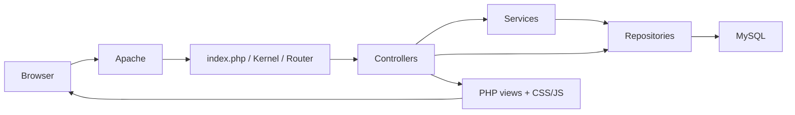

# FMI Schedule (WebProject)

FMI Schedule is a university scheduling and campus planning application built for an FMI web programming project. It manages buildings, floors, rooms, teaching events, and exam requests in one place, helping users find suitable rooms and routes between them.

The application uses PHP with a custom MVC framework, MySQL, server-rendered HTML, CSS, and vanilla JavaScript. Docker provides a local Apache/PHP and MySQL environment; native Apache/PHP installations such as XAMPP are also supported. There is no Composer dependency installation or frontend build step.

## Features

- Manage buildings, floors, rooms, equipment, and room capacities.
- View floor plans on a draggable room grid and buildings from four directions.
- Submit physical, online, and hybrid event requests, including resource and meeting details.
- Approve requests, check room availability, and assign the smallest eligible room.
- Group events into dated schedules and view or print event and schedule reports.
- Find shortest routes through directed room connections, with an option to exclude stairs and apply timed closures.
- Import and export CSV/XML data and ASCII floor plans.
- Use student, teacher, schedule manager, and administrator accounts; inspect audit records as an administrator.

This is a course project with implementation gaps. Allocation optimizes spare room capacity; it does not optimize an entire timetable or simulate campus traffic. Read [known issues](docs/KNOWN_ISSUES.md) before using real data or exposing the application publicly.

## Quick start with Docker

Install Git and Docker with the Compose plugin, then run:

```sh
git clone https://github.com/IvanVenkov712/WebProject.git
cd WebProject
docker compose up --build -d
docker compose logs -f app
```

Open [http://localhost:8080](http://localhost:8080). The app container waits for MySQL, then applies [schema.sql](database/schema.sql) and [seed.sql](database/seed.sql) on every start. Look for `Database ready.` in the logs; Apache can still start after an import failure.

The shipped Dockerfile does not install `mbstring`, which CRUD validation requires. Verify/install it using the [runtime setup notes](docs/SETUP.md#requirements) and [image extension example](docs/DEPLOYMENT.md#build-a-deployment-image).

The checked-in Compose file supplies local database settings directly. Copying `.env.example` is only needed for native PHP runs or a custom container setup; it does not override Compose's fixed `environment:` values.

### Demo accounts

All accounts below use the demo password `Abc123` from the seed file.

| Username | Role |
| --- | --- |
| `admin` | Administrator |
| `schedule_manager` | Schedule manager |
| `teacher` | Teacher |
| `student_anna` | Student |

These are public demonstration credentials. Use a separate database without demo data for deployment. Registration creates an active student account.

### Common commands

```sh
docker compose ps
docker compose logs --tail=100 app db
docker compose stop
docker compose start
docker compose down
```

The named `db_data` volume survives `docker compose down`. Adding `--volumes` deletes the database. Source files are copied into the image; rebuild after editing PHP, templates, JavaScript, CSS, or configuration:

```sh
docker compose up --build -d app
```

## Installation, configuration, and deployment

- [Installation and local runs](docs/SETUP.md): Docker, native Apache/XAMPP, database initialization, and troubleshooting.
- [Environment variables](docs/CONFIGURATION.md): every setting, its purpose, defaults, precedence, and quoting rules.
- [Deployment and operations](docs/DEPLOYMENT.md): schema-only initialization, Apache restrictions, persistent storage, backups, and upgrades.

## Architecture



Controllers handle requests, sessions, validation, and responses. Services implement workflows such as request approval, allocation, and route planning. Repositories issue prepared SQL queries and hydrate lightweight models. Some generic CRUD actions go directly from controllers to repositories.

See [architecture and data relationships](docs/ARCHITECTURE.md), the [component reference](docs/COMPONENTS.md), and the [service reference](services.md) for details.

## Documentation

| Document | Contents |
| --- | --- |
| [User guide and roles](docs/USER_GUIDE.md) | Workflows, permissions, floor plans, requests, schedules, and exports |
| [HTTP interface](docs/HTTP_API.md) | Registered routes, session authentication, payloads, filters, and response conventions |
| [Transfer formats](IMPORT_EXPORT_FORMATS.md) | CSV columns, XML structure, ASCII tokens, and transfer limitations |
| [Known issues](docs/KNOWN_ISSUES.md) | Verified defects, deployment blockers, and differences from the specification |
| [Development](CONTRIBUTING.md) | Working on the code, validation, and maintaining documentation |
| [GitHub metadata](docs/GITHUB_METADATA.md) | Ready-to-use repository description and topics |

[project_requirements.txt](project_requirements.txt) and [project_specification.txt](project_specification.txt) preserve the original Bulgarian assignment and proposed requirements. They include planned behavior that is not fully implemented. The documentation above describes the current source.

## Validation and license

There is no checked-in automated test suite. The [GitLab pipeline](.gitlab-ci.yml) builds and deploys on its configured runner but has no test stage. See [CONTRIBUTING.md](CONTRIBUTING.md) for syntax checks and a manual smoke test.

No license file is currently included; the repository does not declare an open-source license.
