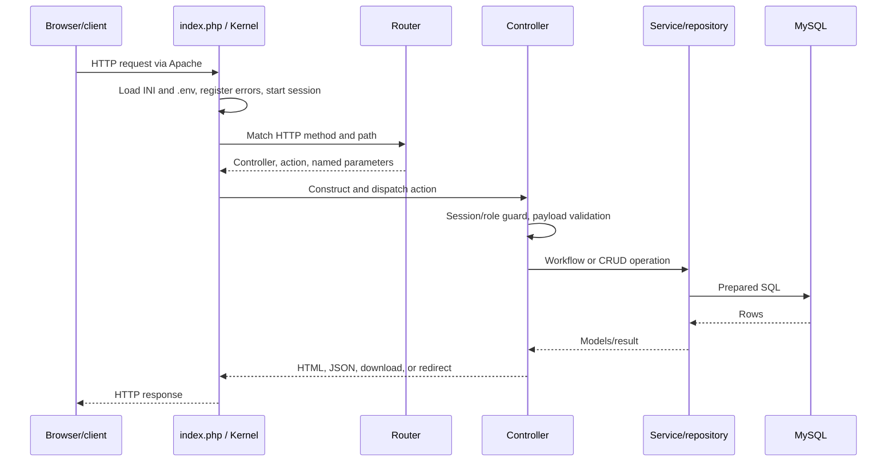
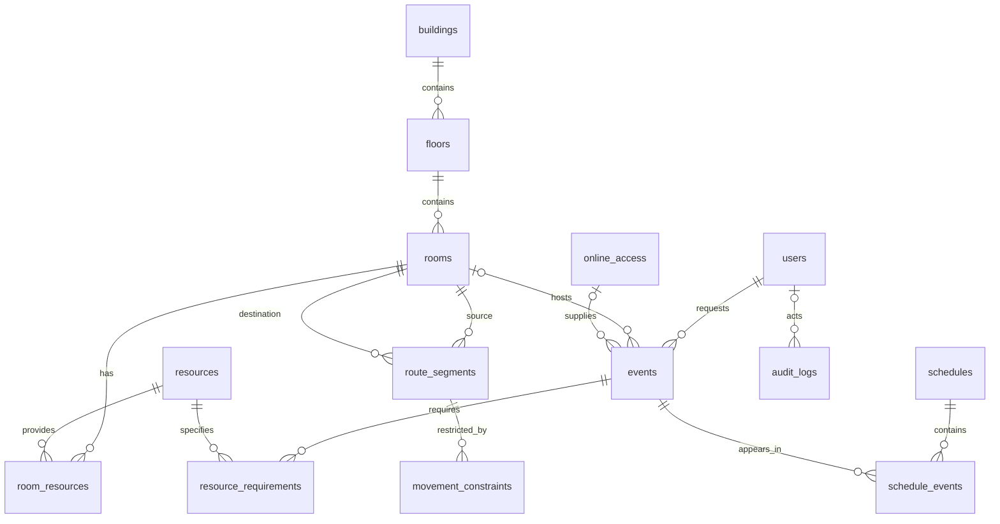

# Architecture

## Runtime and request lifecycle

FMI Schedule is a single PHP application backed by MySQL. Apache serves static assets and rewrites application paths to the root [index.php](../index.php). There is no third-party web framework, dependency injection container, Composer loader, background worker, or WebSocket service.

`Autoloader` maps the `App` namespace to `app/`, with a case-insensitive fallback for namespace/directory case differences. `Kernel` loads configuration and the route table, starts a PHP session, dispatches controllers, and catches exceptions. `Request` handles path parsing, form method overrides, and JSON negotiation.

Routes live in [config/routes.php](../config/routes.php). There is no automatic controller/action discovery or separate `/api` route tree. See the [HTTP reference](HTTP_API.md).

## Layers

| Layer | Responsibility | Dependencies |
| --- | --- | --- |
| `app/core` | Bootstrap, configuration, routing, rendering, base models/repositories, PDO, error handling | PHP runtime |
| `app/controllers` | Request parsing, guards, validation, presentation, redirects, successful-write auditing | Core, helpers, services, repositories |
| `app/services` | Event requests, approval, room allocation, exam setup, publication, routing, transfer | Helpers and repositories; other services when needed |
| `app/repositories` | SQL queries, associations, filters, transactions, model hydration | `Database`, `Repository`, models |
| `app/models` | Public data fields, defaults, limited event status predicates | `Model` |
| `app/helpers` | Time/delivery/resource validation, sessions, string normalization, sensitive-key handling | Models/runtime as needed |
| `app/views` | Server-rendered PHP templates and shared page shell | Controller-provided data and shared UI functions |
| `public` | CSS and vanilla JavaScript; no bundling | Browser |
| `database`, `docker` | SQL fixtures and runtime provisioning | MySQL, Apache/PHP |

This separation is partial: generic CRUD controllers call repositories directly, some SQL-backed validation lives in repositories, and some views contain page-specific JavaScript.

Repositories normally construct their own `Database`/PDO connection unless a dependency is supplied. Services accept optional constructor dependencies for substitution and often pass an existing repository into collaborators. A service transaction covers only operations using that repository's PDO connection; there is no global transaction manager.

## Data model

[database/schema.sql](../database/schema.sql) defines 14 InnoDB tables with `utf8mb4_unicode_ci` collation.

| Tables | Purpose and constraints |
| --- | --- |
| `users` | Unique username/email, password hash, role, active flag. Roles are strings, without a separate roles table. |
| `buildings`, `floors`, `rooms` | Building code, building+floor level, and floor+room position code are unique. A building's `floor_count` limits floor insertion in `FloorRepository`. |
| `resources`, `room_resources` | Equipment/material catalog with quantities per room. The join table has a composite key. |
| `events` | Requests and scheduled activities share one table. References requestor, optional room, and optional online access. |
| `online_access` | Meeting platform, link, access key, and host notes; this stores supplied meeting details, not provider API integration. |
| `resource_requirements` | Quantity and notes per event/resource pair. |
| `schedules`, `schedule_events` | Dated collections of events; no independent published flag. An event can belong to multiple schedules. |
| `route_segments` | Directed room-to-room edges; one edge per ordered pair, distance, capacity, availability, stairs/elevator flags. |
| `movement_constraints` | Timed closure/capacity rules for a segment. |
| `audit_logs` | Actor, action, method/path, entity reference, IP, compact JSON details, timestamp. |

Deleting a building cascades to floors and rooms; events referencing a room prevent that room's deletion. Users referenced by events are also protected from deletion. Deleting events/schedules removes their join rows; deleting resources used by event requirements is restricted. Review the schema before destructive operations.

The schema includes room geometry/entrance/orientation columns that the current `Room` model does not expose. The UI grid persists `position_code` instead; model-based CSV/XML transfers do not preserve the extra schema columns.

## Main workflows

### Event requests and exams

`RequestController` and `EventController::submit_request()` call `EventRequestService`. It validates the event, normalizes resource quantities and optional online data, checks a selected room against approved events, sets status to `pending`, and saves the event and associations in an event-repository transaction.

`EventApprovalService` changes pending requests to `approved` or `rejected`. Approval validates online setup and, for physical/hybrid events, room availability/capacity/resources. Its service-only reschedule operation moves an approved event back to pending.

`ExamSessionSetupService` creates exam events and can allocate a room when none was supplied. Online events require meeting data; hybrid events combine physical room and meeting details.

The generic event CRUD endpoints do not run this entire workflow. Authorization and approval invariants differ by entrypoint; see [known issues](KNOWN_ISSUES.md#event-workflows-and-authorization).

### Availability and allocation

`RoomAvailabilityService` considers an active room eligible when it has enough capacity and resource quantities. Only overlapping **approved** events count as booking conflicts. Overlap is strict: `left_start < right_end && left_end > right_start`, so adjacent intervals can share a room.

`RoomAllocationService` adds delivery-mode compatibility, excludes conflicts other than the event itself, and sorts candidates by `room.capacity - event.student_count`, then capacity and ID. It assigns one event at a time. It does not score walking distance, balance buildings, optimize an exam campaign, or reserve rooms for pending requests.

### Schedule publication

`SchedulePublishingService` can approve a pending event, then validates that the approved event fits within the schedule's start day at 00:00:00 and end day at 23:59:59. Publication inserts a `schedule_events` row, and repeated attachment returns the existing event. Removing a schedule attachment leaves the event and its approval state intact.

Approval happens before schedule validation, so a failed publication can still leave an event approved. Batch publication handles each event independently.

### Routes and constraints

`RoutePlanningService` implements Dijkstra-style shortest-path search over directed segment distances with a linear scan of its queue. An empty array means the same start/end room; `null` means an invalid endpoint or no path. Segments must be available and their destinations active.

Accessible search excludes stairs and, when both times are supplied, rejects segments blocked by movement constraints. Ordinary search does not apply timed constraints. Capacity validation is separately available in `MovementConstraintService`; route search does not model competing groups or timetable traffic.

### Plans and transfer

The floor UI uses a 12-column by 5-row grid, storing coordinates such as `2,1` in `rooms.position_code`; unplaced rooms use other codes. The ASCII plan is stored separately in `floors.ascii_plan`. Import can synchronize room metadata by position code, but dragging does not regenerate the ASCII plan.

CSV/XML imports insert model records and report per-record failures without rolling the whole import back. Exports cover six entity types and omit many relationships. See [transfer formats](../IMPORT_EXPORT_FORMATS.md).

## Authentication, observability, and persistence

Sessions store user ID, role, and a user snapshot without `password_hash`; login regenerates the session ID. Most access checks use that snapshot. Registration creates an active student; elevated roles are assigned separately.

`BaseController` records successful mutations through `AuditLogService` on a best-effort basis. File logging goes to `storage/logs/app.log`; Apache also has access/error logs. JSON sensitive-data filtering and file-log redaction have known defects and must not be assumed to protect secrets.

MySQL is the durable system of record. App logs, exports, and file sessions require explicit persistent storage in container deployments. There is no cache layer, job queue, schema migration runner, or bundled automated test suite.
